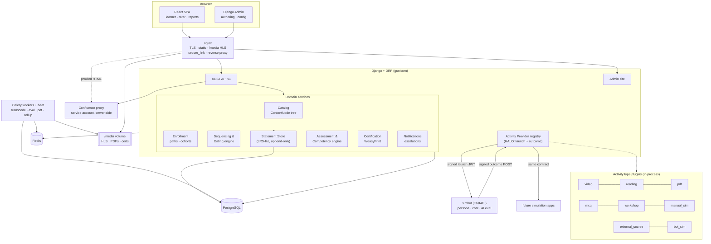

# Hevo Support Training Platform — Architecture & Delivery Plan

## Context

Hevo's CX onboarding today runs on a spreadsheet (`Consolidated Intern Score 2026.xlsx`) plus a manually maintained plan (`Interns Tech Training Plan.xlsx`), Google Forms for quizzes, Confluence/Drive for content, and a standalone Python CLI bot for ticket simulation. Scores are aggregated by hand across five weighted sources; gating ("pass this to unlock the next") is enforced by a human remembering to check. That works for one program run and does not survive 5–6 cohorts a year, nor does it produce a defensible, auditable competency record.

This plan designs a self-hosted platform that does two jobs: (1) acts as a day-by-day onboarding buddy for each new support hire, and (2) is a reusable course-and-certification framework where **new courses, certifications, and activity types are additive — config or plugin, never a core rewrite**.

The deliverable of *this* task is the plan below plus interface contracts and a repo skeleton. It is not an implementation.

**Note:** macOS blocked this session from reading `~/Downloads`, so the two reference spreadsheets were not parsed. The seed model below is derived from the description in the brief. Copy both files into the working directory to have the real course hierarchy, rubric rows, and weight table parsed into seed fixtures.

**Confirmed in this session:** Django + DRF + React SPA · the bot's Python source is ours to refactor · re-hosted video on local disk · V1 usable by a cohort in ~3 months.

---

## 1. Executive summary

A single Django application is the system of record and the admin surface; a React SPA is the learner and rater surface; a small separate Python service (`simbot`) hosts the AI ticket simulation. All three run in Docker Compose behind nginx on one Ubuntu box.

Four ideas carry the extensibility requirement:

1. **One content tree, not five tables.** `ContentNode` is a self-referencing tree (`course → segment → topic → sub-topic`, arbitrary depth) with `Activity` rows hanging off nodes. Adding a level or reordering a course is data, not a migration.
2. **An append-only statement store, xAPI-shaped.** Every completion, score, seek, rating, and sign-off becomes an immutable `Statement` (`actor · verb · object · result`). The core reads statements; it never contains per-activity logic. This is the single seam that makes a new activity type cost one plugin instead of touching progress, gating, scoring, and reporting.
3. **A signed launch + outcome-callback contract ("HALO")** for external tools. The bot is the first implementation; a future simulation app implements the same two endpoints. Claim names are namespaced to mirror LTI 1.3, so a real LTI façade is later an additive adapter.
4. **Rules and weights are rows, not branches.** Prerequisites, mastery thresholds, retake caps, escalation triggers, competency maps, and source weights all live in tables an admin edits. `evaluate(node, user)` is a pure function over those rows.

Certification is competency-based: raw metrics normalise to 0–1, roll up into competencies, then into an overall score using the per-program 10/30/30/20/10 source weights. **Eligibility is driven by completion plus per-competency mastery thresholds — never by ranking.** Every rollup stores its own input snapshot, so a score is explainable a year later.

V1 (≈13 weeks, 6 milestones) ships auth, authoring, the content tree, gating, progress/resume, tracked video, the native quiz engine, the bot chat activity, mentor rubric rating, the weighted rollup, and PDF certificates — enough for a real cohort.

**Where I am deliberately adding complexity:** the statement store and the HALO contract. Both are over-engineered for 10 users judged on today's scope alone; both are the reason V2 features cost days instead of rewrites. **Where I am deliberately not:** no Kubernetes, no microservices, no event bus, no GraphQL, no third-party LRS, no multi-tenancy, no separate auth server, no CQRS. One database, one app, one box.

---

## 2. Recommended tech stack

| Layer | Choice | Why |
|---|---|---|
| Backend | **Django 5.x + DRF**, Python 3.12 | Django admin covers ~80% of the admin-panel requirement on day one (users, roles, content CRUD, rubrics, weights) — the single biggest V1 scope saving. Migrations, RBAC, audit, and auth are batteries-included and boring. Python matches the bot. |
| Frontend | **React 19 + TypeScript + Vite SPA** | Not Next.js: there is no SEO, no public pages, and no SSR requirement — an internal auth-gated app behind a login gains nothing from a Node server, and adding one doubles the runtime surface on a single box. Vite builds to static files nginx serves directly. |
| Data | **PostgreSQL 16** | JSONB for plugin configs, statement payloads, and rollup snapshots; relational integrity everywhere else. One engine, no second store to back up. |
| Cache / broker | **Redis 7** | Sessions, launch-nonce replay cache, Celery broker, bot session scratch state. |
| Async | **Celery + beat** | Video transcode (minutes), LLM evaluation (tens of seconds), PDF render, rollup recompute, nightly digests. All genuinely long-running — this is not premature. |
| Bot service | **FastAPI** (`simbot`), separate container | Native SSE streaming for token-by-token chat, and it isolates slow LLM calls from Django's worker pool. Imports the existing CLI's core logic as a library. |
| Video | **ffmpeg → HLS**, `hls.js` + a tracking wrapper over HTML5 `<video>` | HLS gives adaptive bitrate and, more importantly, cheap range-accurate seeking for the 90%-at-1× rule. |
| PDF | **WeasyPrint** | Certificate templates are HTML+CSS, so a non-developer can restyle them; renders deterministically headless with no browser dependency. |
| Serving | **nginx + gunicorn (sync workers) + Docker Compose**, managed by one systemd unit | Compose gives reproducible upgrades and a rollback story on a single box; systemd gives boot-time start and restart-on-failure. |
| Observability | Structured JSON logs → journald, Sentry, `/healthz` + Uptime Kuma | Proportionate to 10 users. Prometheus/Grafana is an optional add-on, not V1. |

**Rejected:** FastAPI-only backend (you rebuild the admin — 3–5 weeks of V1); Django+HTMX with no SPA (the video player, bot chat, and quiz engine each need real client state, so you land in a hybrid anyway with worse ergonomics); Moodle/Open edX (already ruled out, and correctly — the integration surface is the whole point).

---

## 3. High-level architecture



**Request flow, learner opening a segment:** SPA calls `GET /api/v1/enrollments/{id}/tree` → Sequencing engine evaluates each node's gating rules against materialised `Progress` + `Statement` history → returns the tree with `locked | available | in_progress | complete` per node. Learner opens an activity → the plugin's descriptor tells the SPA which renderer to mount and what config to pass → the renderer emits statements as the learner works → statement writes enqueue a recompute of the affected `Progress` rows and, if a gate flipped, the parent segment's state.

**Request flow, bot session:** learner opens a `bot_sim` activity → platform creates an `Attempt` and a `LaunchSession`, mints a 5-minute launch JWT → SPA opens the in-app chat and calls `simbot` through nginx with that token → `simbot` streams the persona's replies over SSE → on finish, `simbot` enqueues AI evaluation and POSTs a signed outcome document back to `/api/v1/outcomes` → platform validates, writes statements per metric, maps metrics to competencies, updates the rollup, and re-evaluates gates.

---

## 4. Component / service breakdown

| Component | Responsibility | Explicitly not responsible for |
|---|---|---|
| **Catalog** | The `ContentNode` tree, `Activity` rows, plugin config validation against each type's JSON Schema, versioning/publishing of courses | Knowing what any activity type *means* |
| **Enrollment** | Programs, cohorts, learning paths, per-role course allocation, mentor assignments | Gating decisions |
| **Sequencing & Gating** | `evaluate(node, user) → NodeState`; unlock rules; mastery thresholds; retake caps; attempt grants; escalation triggers | Scoring math |
| **Statement Store (LRS-lite)** | Append-only xAPI-shaped statement ingest, validation, voiding, query API, idempotency | Interpreting statements into progress (that's a consumer) |
| **Progress projector** | Celery consumer that folds statements into materialised `Progress` and `AttemptSummary` rows | Being the source of truth (statements are) |
| **Assessment & Competency** | Metric→competency mapping, per-source normalisation, weighted two-stage rollup, ranking, flags, rollup snapshots | Deciding certificate eligibility |
| **Certification** | Eligibility policy evaluation, certificate issuance, serial + verification code, WeasyPrint render, public verify page | Computing scores |
| **Activity Provider registry (HALO)** | Registered external tools, keypairs, launch-token minting, outcome callback validation, idempotency & replay protection | The tools' internals |
| **Activity type plugins** | Per type: JSON Schema for config, SPA renderer key, statement→completion rule, score extraction | Persistence, gating, scoring |
| **Confluence proxy** | Server-side authenticated fetch via service account, sanitise, rewrite asset URLs, cache | Forwarding user credentials (never) |
| **Notifications** | Escalation on retake cap, mentor rating queue, cohort digests. Email in V1; Slack in V2 | — |
| **`simbot` service** | Persona generation from Zendesk tickets, in-character chat, AI evaluation, outcome POST | Storing progress or scores |
| **Media pipeline** | Upload → ffmpeg HLS ladder → thumbnails → duration probe → publish | Playback tracking (client-side) |

---

## 5. Data model

Core entities and the relationships that matter. `→` is FK, `⇉` is M2M.

**Identity & access**
- `User` — custom model, `email` unique (the bot keys on email), `username`, `employee_id`, `is_active`, `must_change_password`, `timezone`.
- `UserIdentity` — `→User`, `provider` (`local|google|okta|...`), `external_id`, `email`. **Present from day one even though V1 only writes `local` rows** — this is the SSO seam; adding Okta later is an INSERT, not a `User` migration.
- `Role` — seed: `trainee`, `trainer`, `mentor`, `panel_member`, `admin`, `function_head`. Maps to a Django Group carrying permissions.
- `RoleAssignment` — `→User`, `→Role`, `scope_type` (`global|program|cohort|course`), `scope_id`. Lets someone be a mentor for cohort 2026-Q1 only.
- `MentorAssignment` — `→mentor User`, `→trainee User`, `→Program`, optional `→Activity` scope. Drives the rating queue.

**Catalog**
- `ContentNode` — `→parent ContentNode` (null = root), `kind` (`course|segment|topic|subtopic`), `title`, `slug`, `order`, `description`, `is_required`, `estimated_minutes`, `→CourseVersion`. Self-referencing tree; arbitrary depth; ordering is a sibling-scoped integer.
  *Trade-off:* one table loses DB-level "a segment cannot parent a course". Enforced in a model `clean()` + serializer validators with a declared allowed-parent map. Worth it — arbitrary hierarchy and additive kinds come free.
- `CourseVersion` — `→root ContentNode`, `version`, `state` (`draft|published|archived`), `published_at`, `→published_by`. Enrollments pin a version so editing a live course cannot break an in-flight cohort.
- `Activity` — `→ContentNode`, `activity_type` (plugin registry key), `title`, `config` JSONB (validated against the plugin's schema), `is_required`, `max_attempts` (default 3), `mastery_threshold` (0–1, nullable), `→ActivityProvider` (nullable), `→Rubric` (nullable), `points`, `order`.
- `MediaAsset` — `→uploaded_by`, `kind`, `original_path`, `hls_manifest_path`, `duration_seconds`, `transcode_state`, `checksum`.

**Programs & enrollment**
- `Program` — a cohort-based run ("CX Onboarding 2026-Q1"), `starts_on`, `ends_on`, `→CompetencyFramework`, `→CertificationPolicy`.
- `Cohort` — `→Program`, `name`, `capacity`. (Kept separate from Program so one program definition can run repeatedly.)
- `LearningPath` — `→Program`, `→Role` or `job_family`, `name`.
- `PathItem` — `→LearningPath`, `→CourseVersion`, `order`, `is_required`, `unlock_rule` JSONB.
- `Enrollment` — `→User`, `→Cohort`, `→LearningPath`, `state`, `enrolled_at`, `completed_at`.

**Gating**
- `GatingRule` — `→ContentNode` (or `→PathItem`), `rule` JSONB (the expression tree from §7), `is_active`, `notes`.
- `AttemptGrant` — `→User`, `→Activity`, `extra_attempts`, `→granted_by`, `reason`, `granted_at`. The auditable escape hatch past a retake cap.
- `EscalationEvent` — `→User`, `→Activity`, `trigger` (`retake_cap|failed_gate|stalled`), `attempt_no`, `notified_roles` JSONB, `state`, `resolved_by`, `resolution_note`.

**Activity records**
- `Attempt` — `→User`, `→Activity`, `attempt_no`, `state` (`in_progress|submitted|passed|failed|abandoned`), `score_raw`, `score_max`, `score_scaled`, `started_at`, `completed_at`, `data` JSONB (quiz responses, watched ranges, transcript ref). Unique on `(user, activity, attempt_no)`.
- `Statement` — **append-only.** `id` UUID (client-suppliable for idempotency), `→actor User`, `verb` (IRI or short key), `object_type`, `object_id`, `result` JSONB (`score`, `success`, `completion`, `duration`, `response`), `context` JSONB (registration, attempt, provider, extensions), `timestamp`, `stored`, `→authority`, `voided_by` (nullable), `raw` JSONB. Indexes: `(actor, object_id, timestamp)`, `(verb, timestamp)`, GIN on `result`.
- `Progress` — materialised projection. `→User`, `→ContentNode`, `state` (`locked|available|in_progress|complete`), `percent`, `first_seen_at`, `completed_at`, `last_position` JSONB (drives resume), `recomputed_at`. Unique on `(user, node)`.

**Assessment & certification**
- `CompetencyFramework` / `Competency` — seed set: Technical Knowledge, Troubleshooting Skills, Communication, Presentation Skills, Attention to Detail, Rapport Building, Research Orientation, Compliance, Coaching. Editable.
- `AssessmentSource` — `→Program`, `key` (`trainer|demo_simulation|mentor|chat_practice|final_1o1`), `label`, `weight` (seed 0.10 / 0.30 / 0.30 / 0.20 / 0.10). Weights validated to sum to 1.0.
- `Rubric` / `RubricMetric` — metric `key`, `label`, `max_score` (default 5), `→Competency` weights via `MetricCompetencyMap`, `guidance` text shown to the rater.
- `MetricCompetencyMap` — `metric_key`, `→Competency`, `weight`. This is the row that makes "debugging → Troubleshooting 0.7 + Technical Knowledge 0.3" configuration rather than code.
- `RubricScore` — `→Attempt`, `→RubricMetric`, `score`, `feedback`, `→rated_by`, `rated_at`. One row per metric per attempt.
- `ScoreRollup` — `→User`, `→Program`, `overall_scaled`, `per_competency` JSONB, `per_source` JSONB, `rank` (nullable, reporting only), `flag` (`green|amber|red`, reporting only), `→ScoreRollupRun`.
- `ScoreRollupRun` — `computed_at`, `engine_version`, `inputs_snapshot` JSONB (every contributing attempt id, raw score, weight, and map used). **This is the audit trail that makes a score explainable months later.**
- `CertificationPolicy` — `→Program`, `require_all_required_activities`, `require_all_segment_gates`, `min_overall_scaled`, `min_per_competency` JSONB, `required_activity_ids` JSONB.
- `CertificateTemplate` — `name`, `html` (Jinja), `css`, `page_size`, `assets`.
- `Certificate` — `→User`, `→Program`, `→CourseVersion` (nullable, for per-course certs), `serial`, `verification_code`, `issued_at`, `→CertificateTemplate`, `scores_snapshot` JSONB, `pdf_path`, `pdf_sha256`. No expiry.

**Integration**
- `ActivityProvider` — `key`, `name`, `launch_url`, `results_public_key` / `shared_secret` (encrypted), `outcome_schema` JSONB, `pii_policy` (`email|opaque_id_only`), `is_active`.
- `LaunchSession` — `→User`, `→Activity`, `→Attempt`, `→ActivityProvider`, `launch_id` UUID, `nonce`, `issued_at`, `expires_at`, `consumed_at`, `state`.
- `OutcomeReceipt` — `→LaunchSession`, `idempotency_key`, `payload` JSONB, `received_at`, `processing_state`, `error`. Raw inbound payloads kept verbatim before interpretation.
- `AuditLog` — `→actor`, `action`, `target_type`, `target_id`, `before`/`after` JSONB, `ip`, `at`. Covers every admin mutation, score override, and attempt grant.

---

## 6. Key interface contracts

### 6.1 HALO — Hevo Activity Launch & Outcome (LTI-1.3-inspired, internal)

**Launch.** Platform mints an `EdDSA`-signed JWT, 5-minute TTL, and the SPA hands it to the tool (embedded iframe or in-app chat calling the tool's API):

```json
{
  "iss": "https://training.hevo.internal",
  "aud": "simbot",
  "sub": "u_8f21c3ae",
  "jti": "nonce_7d3a...",
  "iat": 1772668800, "exp": 1772669100,
  "https://hevo.dev/claim/launch_id": "ls_01HW...",
  "https://hevo.dev/claim/activity_id": "act_4412",
  "https://hevo.dev/claim/attempt_id": "att_99013",
  "https://hevo.dev/claim/attempt_no": 1,
  "https://hevo.dev/claim/roles": ["trainee"],
  "https://hevo.dev/claim/context": {
    "program_id": "prg_2026q1", "cohort_id": "coh_12",
    "course": "Advanced Product Training", "segment": "Issue Simulation"
  },
  "https://hevo.dev/claim/config": { "simulation_number": 3, "difficulty": "medium" },
  "https://hevo.dev/claim/results_url": "https://training.hevo.internal/api/v1/outcomes",
  "https://hevo.dev/claim/return_url": "https://training.hevo.internal/learn/act_4412/done",
  "https://hevo.dev/claim/user": { "email": "trainee@hevodata.com", "name": "A. Trainee" }
}
```

The `user` claim is emitted **only** if the provider's `pii_policy` is `email`; otherwise the tool sees `sub` alone. `simbot` needs email today because its existing output keys on it — record that as a deliberate exception, not the default.

Claim names are namespaced and positionally mirror LTI 1.3 (`sub`, `roles`, `context`, deep-link config, AGS results URL). Exposing a real LTI 1.3 platform later is an additive adapter that re-labels claims — no core change.

**Outcome callback.** `POST {results_url}`, `Authorization: Bearer <tool-signed JWT>`, `Idempotency-Key: <uuid>`:

```json
{
  "launch_id": "ls_01HW...",
  "attempt_id": "att_99013",
  "state": "completed",
  "score": { "raw": 4.2, "max": 5, "scaled": 0.84 },
  "metrics": [
    { "key": "communication", "label": "Communication", "raw": 4, "max": 5, "feedback": "Clear, but opened without acknowledging urgency." },
    { "key": "empathy",       "label": "Empathy",       "raw": 5, "max": 5, "feedback": "..." },
    { "key": "tat",           "label": "Turnaround",    "raw": 3, "max": 5, "feedback": "..." },
    { "key": "concreteness",  "label": "Concreteness",  "raw": 4, "max": 5, "feedback": "..." },
    { "key": "accuracy",      "label": "Accuracy",      "raw": 5, "max": 5, "feedback": "..." },
    { "key": "reference_docs","label": "Doc Reference", "raw": 4, "max": 5, "feedback": "..." }
  ],
  "narrative": { "strengths": "...", "weaknesses": "...", "overall": "..." },
  "evidence": [ { "type": "transcript", "url": "https://simbot.internal/v1/sessions/s_77/transcript", "sha256": "..." } ],
  "external_ref": { "zendesk_ticket_id": "184422", "simulation_number": 3, "simulation_title": "Pipeline stuck in ingesting" },
  "occurred_at": "2026-03-04T11:22:31Z"
}
```

Platform behaviour on receipt: verify signature → check `jti`/nonce not replayed (Redis, TTL = token life) → confirm `launch_id` exists, is unconsumed, and belongs to this provider → persist `OutcomeReceipt` verbatim → for each metric, write one `Statement` (`verb: scored`, `object: activity/metric`) → write `RubricScore` rows if the activity carries a rubric → set `Attempt.score_*` and `state` → enqueue rollup recompute and gate re-evaluation. Duplicate `Idempotency-Key` returns the original `202` and does nothing.

The same contract serves the **structured simulation** mode with metric keys `debugging`, `clarity`, `rca`, `resolution`, `detail` — no schema change, only different rows in `MetricCompetencyMap`.

### 6.2 `simbot` service API

| Method | Path | Purpose |
|---|---|---|
| `POST` | `/v1/sessions` | Body `{launch_token}`. Validates the JWT, reads a set of Zendesk tickets, generates the persona, returns `{session_id, scenario_brief, opening_message}`. |
| `POST` | `/v1/sessions/{id}/messages` | Body `{text}`. Returns `text/event-stream` of assistant tokens (`event: token` / `event: done`). |
| `POST` | `/v1/sessions/{id}/finish` | `202`. Enqueues AI evaluation; the worker POSTs the outcome document to `results_url`. |
| `GET` | `/v1/sessions/{id}` | `{state, turn_count, elapsed_seconds}` — lets the SPA restore a dropped connection. |
| `GET` | `/v1/sessions/{id}/transcript` | Full transcript; served only to a valid platform token (evidence link). |
| `GET` | `/healthz` | Liveness + model reachability. |

Not exposed to the internet — reachable on the Compose network and via one nginx location guarded by launch-token validation. Session state in Redis with a Postgres transcript write on finish. The existing CLI's persona-generation and evaluation functions are imported as a library; the CLI entrypoint stays working for local debugging.

### 6.3 xAPI statement schema (the subset we implement)

```json
{
  "id": "b1c0f2e8-...",
  "actor":  { "account": { "homePage": "https://training.hevo.internal", "name": "u_8f21c3ae" } },
  "verb":   { "id": "https://w3id.org/xapi/video/verbs/played", "display": { "en-US": "played" } },
  "object": { "id": "https://training.hevo.internal/activities/act_4412",
              "definition": { "type": "https://w3id.org/xapi/video/activity-type/video", "name": { "en-US": "Pipeline Failure Triage" } } },
  "result": {
    "extensions": {
      "https://w3id.org/xapi/video/extensions/time": 412.5,
      "https://w3id.org/xapi/video/extensions/played-segments": "0.000-120.400[,]121.000-412.500",
      "https://w3id.org/xapi/video/extensions/progress": 0.91,
      "https://w3id.org/xapi/video/extensions/speed": "1x"
    },
    "duration": "PT6M52S", "completion": true, "success": true,
    "score": { "raw": 4.2, "max": 5, "min": 0, "scaled": 0.84 }
  },
  "context": {
    "registration": "enr_5521",
    "extensions": {
      "https://hevo.dev/claim/attempt_id": "att_99013",
      "https://hevo.dev/claim/tracking_fidelity": "exact",
      "https://hevo.dev/claim/provider": "simbot"
    },
    "contextActivities": { "parent": [ { "id": ".../nodes/seg_88" } ], "grouping": [ { "id": ".../programs/prg_2026q1" } ] }
  },
  "timestamp": "2026-03-04T11:22:31Z"
}
```

**Verbs used:** `initialized`, `experienced`, `played`, `paused`, `seeked`, `completed`, `attempted`, `answered`, `passed`, `failed`, `scored`, `rated`, `terminated`, plus `voided` for corrections. Video extensions follow the ADL xAPI Video Profile so a real LRS can consume the store unchanged.

**Ingest API:** `POST /api/v1/statements` (single or array, client-supplied `id` = idempotency), `GET /api/v1/statements?agent=&verb=&activity=&since=` . Deliberately *not* full xAPI conformance — no attachments, no signed statements, no state/agent-profile APIs. Documented as "xAPI-shaped, swappable": a `StatementSink` interface with a `LocalPostgresSink` default and a `RemoteLRSSink` stub, so pointing at Learning Locker later is a settings change.

---

## 7. Gating / sequencing engine

Rules are a small JSON expression tree, stored per node, evaluated by a pure function with no side effects:

```json
{ "op": "and", "terms": [
    { "op": "all_required_activities_complete", "node": "seg_88" },
    { "op": "activity_passed", "activity": "act_quiz_88", "min_scaled": 0.8 },
    { "op": "or", "terms": [
        { "op": "mentor_signoff", "activity": "act_ws_12" },
        { "op": "manual_override", "by_role": "function_head" } ] },
    { "op": "date_window", "from": "2026-03-01", "to": null }
] }
```

Leaf predicates in V1: `all_required_activities_complete` · `activity_passed(min_scaled)` · `activity_completed` · `node_complete` · `mentor_signoff` · `attempts_remaining` · `date_window` · `manual_override(by_role)` · `competency_at_least(competency, min_scaled)`. Each is a small function in a registry keyed by `op` — adding a predicate is one function plus one admin form hint, never a change to the evaluator.

**Evaluation.** `evaluate(node, user)` reads only `Progress`, `Attempt`, and `ScoreRollup` rows — never recomputes from raw statements at request time. Recomputation is triggered by the statement projector: a statement write enqueues `recompute_progress(user, node)`, which walks up ancestors and re-evaluates siblings whose rules reference the changed node. For 10 users this is milliseconds; the materialisation exists so the learner tree renders in one query, not N.

**The standard segment gate** is a convention, not special code: every segment gets a rule requiring its terminal assessment activity passed at `mastery_threshold`. Authors get a "add standard gate" button in the admin that writes that row.

**Retakes & escalation.** `Activity.max_attempts` defaults to 3 (2 retakes). On a failed attempt the engine checks `attempts_used >= max_attempts + granted_extra`:
- attempts remain → learner sees a retake button with the count shown;
- cap reached → create `EscalationEvent(trigger=retake_cap)`, notify the `function_head` role (scoped) and the assigned mentor, and lock the retake button. Only an `AttemptGrant` (admin or function head, with a mandatory reason) reopens it. Every grant is in `AuditLog`.

Prerequisites, thresholds, caps, and escalation targets are all rows. **There are no `if activity_type == ...` branches anywhere in the engine** — that is the invariant to protect in code review.

---

## 8. Assessment & certification engine

**Stage 1 — metrics → competencies.** Everything normalises to `scaled ∈ [0,1]` on ingest (`raw / max`), so a /5 rubric, a /100 quiz, and a bot score are commensurable. For a competency `c` within source `s`:

```
score(c, s) = Σ(scaled_m × weight(m,c)) / Σ(weight(m,c))    over metrics m in source s mapped to c
```

**Stage 2 — sources → overall.** Using `AssessmentSource.weight` (seed 10/30/30/20/10):

```
overall      = Σ_s weight(s) × source_scaled(s)
per_comp(c)  = Σ_s weight(s) × score(c,s) / Σ_s weight(s)   over sources that touch c   (renormalised)
```

Sources with no data yet are excluded and the remainder renormalised, so a mid-program rollup is meaningful rather than artificially depressed — with an `is_partial` flag and a `coverage` percentage on the rollup so nobody mistakes a week-2 number for a final one.

**Eligibility vs. reporting — kept structurally apart.** `CertificationPolicy` evaluates: all required activities complete · all segment gates passed · all required bot sims and manual sims complete · `overall_scaled ≥ min_overall` · every entry in `min_per_competency` satisfied. `rank` and `flag` (Green/Red from the Final 1-o-1) live on `ScoreRollup` for reporting and are **never read** by the eligibility check. A relative ranking must not decide whether a competent trainee is certified.

**Audit trail.** Each recompute writes a `ScoreRollupRun` with an `inputs_snapshot` naming every contributing attempt, its raw and scaled score, the weights and maps applied, and the engine version. Score disputes and retake escalations are then answerable from data. Corrections never mutate statements — a correcting statement voids the original (xAPI `voided` pattern), and the rollup re-runs.

**Certificate issuance.** Eligibility is re-evaluated on every rollup; on first pass, a Celery task allocates a serial (`HEVO-CX-2026-0007`) and a random verification code, renders the `CertificateTemplate` through WeasyPrint with a frozen `scores_snapshot`, stores the PDF and its SHA-256, writes an `issued` statement, and emails the learner. `GET /verify/{code}` is a small public page showing name, program, issue date, and serial — no scores. No expiry; revocation is a state change with a reason, kept in the audit log.

---

## 9. Content embedding strategy per source

| Source | Embedding approach | Completion mechanic | Fidelity |
|---|---|---|---|
| **Re-hosted video** | ffmpeg → HLS on the local `/media` volume; nginx `secure_link` signed URLs; `hls.js` + tracking wrapper in-app | 90% of unique content at ≤1×, server-revalidated (§10) | Exact |
| **YouTube** | IFrame Player API, in-app, `origin` locked, no related videos | Same interval algorithm from polled position; **plus a mandatory checkpoint question**, because the tracking alone is not trustworthy | Best-effort (flagged) |
| **Confluence / internal wiki** | **Server-side proxy, not an iframe.** Django fetches `body.export_view` via a service-account API token, sanitises with `bleach` (allowlist, scripts stripped), rewrites image/attachment URLs through the same proxy, caches 15 min. Space allowlist + per-user authz before every fetch. | Scroll depth ≥ 90% + explicit "I've read this", or a checkpoint question | Good |
| **Google Docs / Drive** | Two modes: `/preview` iframe for living documents; **export to HTML and re-host** for canonical content (preferred — Google gives no completion signal) | Dwell time ≥ estimated read time + acknowledge; optional checkpoint question | Weak (iframe) / Good (re-hosted) |
| **PDF** | `pdf.js` viewer in-app | Pages-visited set ≥ 90% of pages | Good |
| **External course (Scaler, KodeKloud)** | Cannot be embedded. Launch button + attestation form + optional certificate/screenshot upload | Learner attests → **trainer or mentor verifies** → optionally a native MCQ that actually tests the material. Verification, not attestation, completes it. | Attested + verified |
| **Hands-on workshop** | In-app task checklist with instructions; artifact submission (screenshot, resource ARN/URL, or text) | Trainer sign-off on the submitted artifact (`mentor_signoff` predicate) | Human-verified |
| **MCQ / Q&A** | Native quiz engine | Auto-scored against `mastery_threshold` | Exact |
| **Bot simulation** | In-app chat, HALO launch | Outcome callback with metric scores | Exact |
| **Manual simulation** | Rater UI in the SPA (mentor role) | Rubric metrics /5 + written feedback, submitted | Human-rated |

**Note on Confluence:** the proxy approach is the only one that reliably renders auth-gated Atlassian content in-app without handling user credentials, but it does re-serve Atlassian content from our server — confirm this is acceptable under your Atlassian terms before building it. Fallback if not: link out with a checkpoint question, at the cost of leaving the app.

---

## 10. Video tracking design

**The rule:** complete when ≥90% of the video's *unique* content has been watched at ≤1× speed. Scrubbing to the end must not count.

**Client algorithm (re-hosted video).**
1. Maintain a set of watched intervals. Sample on `timeupdate` (~250ms) with a `requestAnimationFrame` guard against throttled background tabs.
2. Extend the current interval only while `playbackRate <= max_credited_rate` (config, default `1.0`). Time at >1× accumulates into a separate `uncredited_segments` set — reported for transparency, excluded from progress.
3. `seeking` closes the current interval. A forward jump creates no coverage, so scrubbing to the end yields `progress ≈ 0`.
4. Merge overlaps, serialise as the xAPI Video Profile string `0.000-120.400[,]121.000-412.500`.
5. `progress = Σ credited interval lengths / duration`. At `≥ completion_threshold` (0.9) emit `completed`.
6. Persist ranges every 15s, on `pause`, and on `visibilitychange`/`pagehide` via `navigator.sendBeacon` → this is also what powers resume (`Progress.last_position`).

**Server-side revalidation — this is the part that makes the rule real.** On a `completed` statement the backend independently:
- recomputes the union from the submitted raw ranges (never trusts the client's `progress` number);
- checks wall-clock plausibility: `stored(completed) − stored(initialized) ≥ 0.9 × credited_duration × 0.95`. You cannot watch 20 minutes of video in 3 minutes;
- requires ≥ `ceil(duration / 30s)` heartbeat statements for the session;
- rejects ranges exceeding `duration`, negative, or non-monotonic in arrival;
- records `hidden_fraction` (time the tab was backgrounded) on the statement — over a threshold, mark the completion `needs_review` rather than rejecting it, and surface it in the trainer's report.

Rejected completions write a `failed` statement with a reason and do not unlock anything. Rate-limit statement ingest per session.

**YouTube fallback.** Same interval algorithm, but position comes from polling `getCurrentTime()` at 1s and rate from `getPlaybackRate()`. There are no reliable seek events, so a position discontinuity >1.5s is treated as a seek and closes the interval. Statements carry `tracking_fidelity: "best_effort"`, and the activity type **requires** a paired checkpoint question — the video completion alone never unlocks a gate. Prefer re-hosting anything that gates a segment.

---

## 11. Auth, roles & security

**First-party auth (V1).** Django `ModelBackend` over the custom `User`, Argon2 hashing, `django-axes` for lockout (5 failures / 15 min), a password policy, and `must_change_password` on first login. **Session cookies, not JWTs** for the SPA — same-origin, `HttpOnly`, `Secure`, `SameSite=Lax`, CSRF token on every unsafe method. This is strictly safer than storing a token in JS and there is no cross-domain requirement to justify the alternative.

**The SSO seam.** Three things make Google/Okta additive rather than surgical: (a) `UserIdentity` exists from day one, so identity is never `User.username`; (b) all authentication goes through an `IdentityProvider` protocol (`authenticate() → User`, `provision(claims) → User`) with `LocalPasswordProvider` as the only V1 implementation; (c) no code reads `request.user.username` for identity — `user.id` internally, `email` only at integration boundaries. V2 adds `mozilla-django-oidc` as a second provider plus a "link account" flow. No `User` migration.

**RBAC.** Django Groups/Permissions as the base, plus `RoleAssignment` for scoped roles. All object-level authorisation funnels through one `can(user, action, obj) → bool` helper used by both DRF permission classes and admin `has_*_permission` hooks — one place to audit, one place to test. Seed matrix:

| | trainee | trainer | mentor | panel | admin | function_head |
|---|---|---|---|---|---|---|
| Own learner tree / attempts | ✓ | — | — | — | ✓ | ✓ |
| Author content, quizzes | — | ✓ | — | — | ✓ | — |
| Rate assigned trainees' sims | — | ✓ | ✓ (assigned only) | ✓ | ✓ | ✓ |
| Manage users, roles, weights | — | — | — | — | ✓ | — |
| Grant extra attempts | — | — | — | — | ✓ | ✓ |
| Cohort reports, escalations | — | own courses | own trainees | — | ✓ | ✓ |
| Issue / revoke certificates | — | — | — | — | ✓ | — |

**Embedded auth-gated content.** User credentials are never forwarded to Confluence or anywhere else. A service account fetches; the platform authorises the user against the activity first; content is sanitised server-side; proxied HTML renders under a restrictive CSP with scripts stripped; only allowlisted spaces/pages are proxiable. This is the one component where a mistake becomes an internal-wiki data leak, so it gets its own test suite.

**Everything else:** HSTS + TLS (certbot, or an internal CA if intranet-only), a strict CSP with a per-request nonce, secrets in a `0600` env file or systemd credentials (never the repo), DRF throttling, `AuditLog` on every admin mutation and score override, `simbot` unreachable from the internet, launch tokens single-use with a Redis nonce cache. Bot transcripts contain real Zendesk customer data — set a retention policy (suggest 180 days, then transcript purge keeping only scores) and keep them out of any export.

---

## 12. Admin panel capabilities

Mostly Django admin with custom `ModelAdmin`s and a handful of purpose-built SPA screens where a form isn't enough.

**Author / trainer**
- Create a course; add segments, topics, sub-topics; drag-reorder siblings (custom widget); add activities of any registered type with a type-specific config form generated from the plugin's JSON Schema.
- Upload a video (transcode status shown), set `completion_threshold` and `max_credited_rate`.
- Build quizzes: single/multi choice, true-false, short answer with regex/keyword match, ordering, scenario-with-sub-questions; per-question points, shuffle, feedback, pass threshold.
- Add the standard segment gate with one button; or hand-edit the rule tree with a guided builder and a live "who would be unlocked" preview.
- Publish a course version; in-flight enrollments stay pinned to the old one.
- Preview any activity as a trainee.

**Mentor / senior (rater)**
- A rating queue of assigned trainees' pending simulations.
- Score each rubric metric /5 with the author's guidance text inline, add per-metric written feedback, submit. Draft-save; edits allowed until submit, then locked (an amendment is a new versioned rating, audit-logged).
- See a trainee's full attempt history, bot transcripts, and competency profile.

**Admin**
- Users: create, deactivate, reset password, assign scoped roles.
- Cohorts and programs: create, enroll (individually or CSV), assign learning paths, assign mentors to trainees.
- Learning paths: per-role ordered course sets, required vs. optional, unlock rules between courses.
- Competency framework: add/rename competencies; edit the `MetricCompetencyMap` weights.
- Assessment sources and weights per program, with a sum-to-1.0 validator.
- Certification policy: overall and per-competency minimums, required activity list.
- Certificate templates: edit HTML/CSS, preview with sample data.
- Grant extra attempts (reason mandatory); override a score (reason mandatory, audit-logged, original preserved).
- Register an Activity Provider: name, launch URL, keypair, PII policy.

**Function head**
- Cohort dashboard: progress heatmap, per-competency averages, at-risk list, ranking.
- Escalation inbox: retake-cap events with the trainee's history, resolve with a note or grant an attempt.
- Export a cohort's scores to CSV/XLSX (this replaces the consolidated spreadsheet).

**Trainee (learner UI, for completeness)**
- Dashboard: what's next, days into program, overall progress.
- Course player: tree with lock states, free back-and-forth within an unlocked topic, resume exactly where left off, progress at topic/segment/course level.
- Attempt history with feedback, remaining retakes, competency profile, certificate download.

---

## 13. Non-functional plan for a single Ubuntu box

**Sizing.** 4 vCPU / 8 GB RAM / 200 GB SSD is generous for 10 concurrent learners. Media dominates disk: budget ~1.5 GB per hour of source video after the HLS ladder (720p+480p), so ~50–80 GB for a full library. Transcode is the only CPU spike — it runs in a Celery worker with `--concurrency=1` and a `nice` level so it can't starve web requests.

**Deployment.** Docker Compose (`nginx`, `web`/gunicorn, `worker`, `beat`, `postgres`, `redis`, `simbot`) supervised by one systemd unit. Upgrade: tag → `docker compose pull` → **`pg_dump` first** → `docker compose run --rm web ./manage.py migrate` → `up -d`. Rollback = previous image tag + the pre-deploy dump. Migrations kept backwards-compatible one release (add column → deploy → backfill → drop next release) so a rollback never needs a restore.

**Backups.** Nightly `pg_dump -Fc` (30 daily / 12 monthly), retained locally *and* pushed encrypted (`age` or `restic`) off-box to object storage or a second host. Media `restic` snapshot nightly — media is large but immutable, so incrementals are cheap. Certificate PDFs are regenerable from `scores_snapshot`, but back them up anyway since the SHA-256 is their integrity anchor. **Run a restore drill into a scratch container quarterly and document the runtime** — an untested backup is not a backup.

**Monitoring.** `/healthz` (DB, Redis, Celery ping) and `/healthz/simbot`; Uptime Kuma hitting both every minute with email alerts; Sentry for exceptions on web, worker, and `simbot`; structured JSON logs to journald with `journald` rotation (add Loki only if log search becomes a real need). Celery queue depth and transcode failures surfaced on the admin dashboard rather than a separate stack. Alert on: any endpoint down, Celery queue > 50, disk > 80%, failed backup, `simbot` model errors, and `needs_review` video completions.

**Audit & retention.** `AuditLog` and `Statement` are append-only and never pruned (they're small: ~5k statements per trainee per program). Bot transcripts purge at 180 days. `OutcomeReceipt` payloads retained 1 year.

**Scale-out seam** (not built, kept possible): app containers hold no local state — sessions in Redis, media behind a `StorageBackend` interface whose default is local disk and whose alternative is S3-compatible. Growing past one box means moving Postgres and Redis to managed/dedicated hosts and putting a load balancer in front of N `web` containers. No code change beyond settings. Explicitly out of scope for V1.

---

## 14. Phased roadmap

**V1 — ~13 weeks, shippable for the next cohort.** Ordered so something is demoable from week 3 and the riskiest integration (the bot) lands with buffer.

| Milestone | Weeks | Scope | Done when |
|---|---|---|---|
| **M1 Foundations** | 1–2 | Repo, CI (ruff/mypy/pytest/vitest), Compose stack, custom `User` + `UserIdentity`, RBAC + `can()` helper, `ContentNode`/`Activity`/`CourseVersion` models, admin CRUD, seed the real training plan as a fixture | An admin can author the full 2026 course tree in the admin |
| **M2 Learner core** | 3–5 | SPA shell + auth, statement store + ingest API, progress projector, gating engine v1 + rule builder, course player with tree/lock states/back-and-forth/resume, `reading` and `pdf` plugins, Confluence proxy | A trainee walks a real reading-only segment end to end, closes the tab, and resumes exactly where they were |
| **M3 Video + quiz** | 5–7 | HLS pipeline, tracked player, 90%-at-1× with server revalidation, YouTube fallback plugin, quiz engine (6 question types, scoring, attempt history), retake caps + escalation events + notifications | Scrubbing a video to the end does not complete it; failing a quiz 3× escalates to the function head |
| **M4 Providers + bot** | 7–9 | HALO contract (launch minting, outcome callback, idempotency, replay protection), `ActivityProvider` registry, `simbot` FastAPI wrap of the existing CLI, in-app SSE chat UI, outcome → statement → competency ingestion | A trainee completes a bot ticket chat in-browser and sees the six metric scores and feedback on their profile |
| **M5 Assessment + certification** | 9–11 | Competency framework, `MetricCompetencyMap` admin, mentor rating UI + assignment + queue, `manual_sim`/`workshop`/`external_course` plugins, two-stage weighted rollup + `ScoreRollupRun`, `CertificationPolicy`, WeasyPrint certificate + verify page, cohort export | A synthetic trainee with all sources populated produces the correct overall score against a hand-computed spreadsheet, and issues a PDF |
| **M6 Hardening + pilot** | 11–13 | Backups + tested restore, monitoring, audit coverage, load-sanity, security pass on the proxy and HALO, **a non-developer authors a course unaided**, UAT with 2 trainees, runbook + admin guide | Restore drill passes; the non-dev authoring test passes without help |

**V2 (post-cohort, ~6–8 weeks)** — enterprise SSO via OIDC (Google Workspace / Okta) + account linking; Slack notifications and cohort digests; authoring UX polish (bulk import from the training-plan xlsx, course duplication, template segments); cohort dashboards, ranking, and competency-gap views; question bank with randomisation and per-attempt shuffling; a second simulation provider proving the HALO contract with zero core changes; an LTI 1.3 platform façade if an external tool needs it; mobile-responsive learner UI.

**V3+** — swap `LocalPostgresSink` for a real LRS if xAPI analytics justify it; warehouse export for people analytics; adaptive paths (skip content a trainee demonstrably knows); recommendations from competency gaps; extend beyond CX to other functions (this is where the "reusable framework" claim gets tested); scale-out if concurrency ever demands it.

---

## 15. Risks & mitigations

| Risk | Impact | Mitigation |
|---|---|---|
| **The bot CLI resists being a service** (global state, interactive prompts, blocking I/O) | M4 slips; V1's headline feature is late | Spike this in **week 1, not week 7** — a 2-day timebox to import its persona and eval functions and drive them from a script. If it resists, fall back to the documented subprocess adapter behind the same HALO contract; the platform side is unaffected either way. |
| **LLM evaluation is inconsistent** — same answer scored differently across runs | Trainees dispute scores; certification loses credibility | Pin the model and prompt version on every outcome; store the full eval prompt and response in `OutcomeReceipt`; calibrate against 20 human-rated transcripts before go-live; keep bot sources at 20–30% of the total weight (as designed) so no single AI judgement decides certification; give mentors an override with a mandatory reason. |
| **Video tracking gets gamed** | The 90% rule is theatre | Server-side revalidation is in scope, not optional (§10). Gate segments on re-hosted video only; always pair YouTube with a checkpoint question. |
| **Confluence proxy breaks or violates terms** | Wiki activities unavailable | Space allowlist and caching from day one; the `reading` plugin supports a link-out + checkpoint-question mode as a same-day fallback; confirm Atlassian terms before M2 ends. |
| **Content authoring is too hard for non-developers** | Admins ask engineers to add courses; the framework claim fails | The M6 exit criterion is an unaided authoring test by a real non-dev. Schema-generated config forms, guided rule builder, trainee preview, and course duplication all exist to serve this. Treat a failed authoring test as a release blocker. |
| **Single box is a single point of failure** | A disk or host loss stops all training | Tested restore drill, off-box encrypted backups, immutable media snapshots, documented rebuild runbook with a target RTO (suggest 4 hours). Accept the risk explicitly for 10 users rather than pretending HA is needed. |
| **Scope creep during V1** | Nothing ships for the next cohort | The V1 table above is the contract. Anything new lands in V2 unless it displaces something. The competency-weight *UI* can degrade to admin forms; the *engine* cannot. |
| **Over-engineering for 10 users** | Maintenance burden exceeds the value | Two abstractions are deliberate (statement store, HALO) and justified by the additive-extension requirement. Everything else stays boring. Review any new abstraction against "does this make a new course, cert, or activity type cheaper?" |
| **Statement store grows unbounded** | Query slowdown years out | ~5k statements/trainee/program → ~300k rows/year. Trivial for Postgres with the stated indexes. Revisit partitioning only past ~50M rows. |

---

## 16. Open questions & assumptions

**Assumptions made (labelled, proceeding on them):**
1. `simbot` can import the existing CLI's core logic as a library — spiked in week 1 (see Risks).
2. A Zendesk API service account (or a static export of tickets) is available to the bot for persona generation.
3. A Confluence service-account API token can be issued for the proxy, and re-serving that content internally is acceptable under Atlassian terms.
4. SMTP relay is available for notifications and certificate delivery.
5. The platform is intranet-only or VPN-gated; no public internet exposure beyond the certificate `/verify` page.
6. Videos to be re-hosted exist as downloadable source files (not only as embeds we don't own).
7. Trainee identity is Hevo email, and email is stable for the duration of a program (bot outputs key on it).
8. Certificates are per-program by default; per-course certificates are supported but not seeded.
9. Google Forms quiz history does not need migrating — V1 starts fresh with the native engine.
10. xAPI-shaped-but-not-conformant is acceptable for V1, with the `StatementSink` swap documented (this was flagged in the brief as needing confirmation — **confirming it as a yes unless you say otherwise**).

**Open questions for you:**
1. **The two spreadsheets** — copy them into the working directory and I'll parse the real hierarchy, rubric metric names, and weight rows into seed fixtures. Right now the seed is inferred from your brief.
2. **`min_overall_scaled` and per-competency minimums** — what are today's actual pass bars? The engine needs seed numbers.
3. **Who is the "Function Head" role** in practice, and should escalation go to email, Slack, or both in V1?
4. **Server** — does the Ubuntu box exist yet, and what are its specs, TLS story (internal CA vs. certbot), and network reachability?
5. **Team and capacity** — who builds this, and how many engineer-weeks are actually available across the 13 weeks? The milestone table assumes roughly 1.5 FTE.
6. **Confluence spaces** to allowlist, and whether the RCA/product-doc spaces contain anything a trainee shouldn't see.
7. **Zendesk ticket sourcing** for the bot — live API, or a curated frozen set? A curated set is better for fair, repeatable assessment.
8. **Transcript retention** — is 180 days right, given transcripts contain real customer data?

---

## Proposed repository skeleton

```
training-platform/
├── docker-compose.yml              # nginx, web, worker, beat, postgres, redis, simbot
├── docker-compose.prod.yml         # prod overrides: volumes, secrets, restart policies
├── Makefile                        # up, migrate, seed, test, backup, restore-drill
├── deploy/
│   ├── nginx/                      # TLS, SPA static, /media secure_link, /simbot proxy
│   ├── systemd/training.service    # supervises the compose stack
│   └── backup/                     # pg_dump + restic scripts, restore-drill.sh
├── docs/
│   ├── architecture.md             # this plan, kept current
│   ├── halo-contract.md            # launch + outcome spec for tool authors
│   ├── xapi-profile.md             # verbs, extensions, examples we emit
│   ├── admin-guide.md              # non-developer authoring guide
│   └── runbook.md                  # deploy, restore, incident, on-call
├── backend/
│   ├── config/                     # settings/{base,dev,prod}.py, urls, celery, asgi
│   ├── apps/
│   │   ├── accounts/               # User, UserIdentity, IdentityProvider protocol, RBAC, can()
│   │   ├── catalog/                # ContentNode, Activity, CourseVersion, MediaAsset
│   │   ├── enrollment/             # Program, Cohort, LearningPath, Enrollment, MentorAssignment
│   │   ├── statements/             # Statement model, ingest API, StatementSink, projector tasks
│   │   ├── sequencing/             # rule predicates registry, evaluator, Progress, escalations
│   │   ├── activities/             # plugin base + registry
│   │   │   └── plugins/            # video/ reading/ pdf/ mcq/ workshop/ external_course/
│   │   │                           #   manual_sim/ bot_sim/ — each: schema.py, completion.py, meta.py
│   │   ├── providers/              # ActivityProvider, launch tokens, outcome callback, HALO
│   │   ├── assessment/             # Competency, Rubric, maps, rollup engine, ScoreRollupRun
│   │   ├── certification/          # policy, Certificate, WeasyPrint render, verify view
│   │   ├── proxying/               # Confluence fetch + sanitise + cache
│   │   ├── media_pipeline/         # ffmpeg HLS tasks, signed URL issuance
│   │   ├── notifications/          # email now, Slack in V2
│   │   └── audit/                  # AuditLog model + mixins
│   ├── fixtures/                   # seed roles, competencies, source weights, the 2026 course tree
│   └── tests/                      # pytest; gating/, rollup/, video_validation/, halo/ are the critical suites
├── frontend/
│   ├── src/
│   │   ├── app/                    # router, session provider, layout
│   │   ├── features/
│   │   │   ├── learner/            # dashboard, course tree, player shell, resume
│   │   │   ├── renderers/          # one per activity type, keyed by plugin registry
│   │   │   │   ├── VideoPlayer/    # hls.js + interval tracker + beacon persistence
│   │   │   │   ├── Quiz/  Reading/  PdfViewer/  BotChat/  Workshop/
│   │   │   ├── rater/              # mentor rubric queue + scoring form
│   │   │   └── reports/            # cohort dashboard, competency profile, exports
│   │   └── lib/                    # api client, statement emitter, auth, csrf
│   └── vite.config.ts
└── simbot/
    ├── app/                        # FastAPI: sessions, SSE chat, finish, healthz
    ├── core/                       # imported from the existing CLI: persona, chat, evaluate
    ├── outcomes.py                 # builds + signs the HALO outcome document
    └── cli.py                      # the original entrypoint, kept for local debugging
```

---

## Verification (how we prove each milestone works)

- **Gating engine** — property tests over generated rule trees and progress states; a golden-file test replaying a full synthetic trainee journey (pass, fail, retake, cap, escalation, grant, complete) and asserting every intermediate lock state. This is the highest-risk logic; it gets the strictest suite.
- **Video rule** — integration tests that submit adversarial range sets (scrub-to-end, 2× playback, overlapping duplicates, ranges beyond duration, impossibly fast wall-clock) and assert the server rejects each. Plus one manual browser run per browser we support.
- **Rollup math** — a fixture trainee with all five sources populated, asserted against a hand-computed spreadsheet checked into `tests/`. Any engine change must keep that number stable or explain itself.
- **HALO contract** — a stub provider in the test suite that performs a real launch and posts a real outcome; assert signature rejection, replay rejection, idempotent duplicate, and correct statement/competency fan-out. Then the same test pointed at `simbot`.
- **End-to-end** — Playwright: log in as a trainee, walk a segment (read → watch → quiz → bot chat), fail the quiz, retake, pass, unlock the next segment, get rated by a mentor, reach eligibility, download the PDF, verify it at `/verify/{code}`.
- **Non-developer authoring** — a scripted, observed session where someone outside engineering authors a new course with three activity types and a gate, unaided. Pass/fail, and it blocks the V1 release.
- **Restore drill** — `make restore-drill` restores last night's backup into a scratch stack and runs the E2E suite against it. Quarterly, timed, recorded in the runbook.
